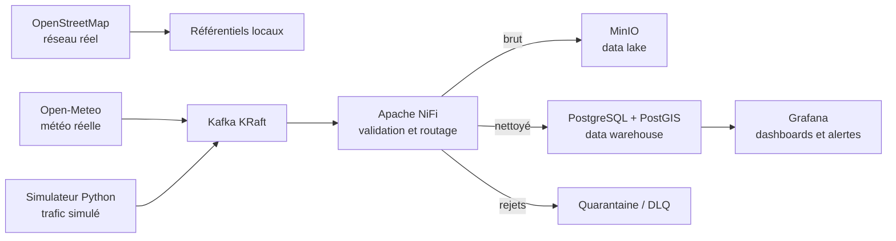

# Lome Smart Traffic

Plateforme locale de surveillance du trafic routier de Lomé, construite autour d'un pipeline de données en streaming.

> **Provenance des données :** le réseau routier OpenStreetMap et la météo Open-Meteo sont réels. Les mesures de trafic et les événements sont simulés ; aucune donnée publique de capteurs de trafic pour Lomé n'est revendiquée.

## Architecture cible



## Avancement

- [x] Phase 0 — initialisation et conventions
- [ ] Phase 1 — infrastructure Docker Compose
- [ ] Phase 2 — référentiels OSM et contrats de données
- [ ] Phase 3 — simulateur
- [ ] Phase 4 — ingestion NiFi et data lake
- [ ] Phase 5 — entrepôt PostGIS
- [ ] Phase 6 — transformation et chargement
- [ ] Phase 7 — qualité et observabilité
- [ ] Phase 8 — alertes
- [ ] Phase 9 — dashboards Grafana
- [ ] Phase 10 — tests, CI et durcissement
- [ ] Phase 11 — documentation portfolio
- [ ] Phase 12 — release

## Prérequis et démarrage

La cible est une exécution 100 % locale via Docker Compose. Installer Docker Desktop avec Compose v2, Git et Make (ou GNU Make sous Windows via WSL). À partir de la phase infrastructure :

```sh
cp .env.example .env
make up
```

Les services, ports et étapes de bootstrap seront précisés dans les phases suivantes. La phase 0 ne démarre encore aucun service.

## Données et licences

Les données OpenStreetMap sont soumises à l'ODbL et doivent être attribuées : « © OpenStreetMap contributors (ODbL) ». Open-Meteo est la source prévue pour la météo ; les conditions d'utilisation et limites de requêtes seront documentées avant intégration. Les événements et mesures de trafic synthétiques seront toujours marqués `data_origin=simulated`.

## Structure

Les répertoires `simulator/`, `nifi/`, `sql/`, `grafana/`, `scripts/`, `tests/`, `data/` et `docs/` accueillent les composants prévus. Les répertoires encore vides sont conservés par `.gitkeep` jusqu'à leur première implémentation.

## Conventions

- Documentation en français ; code, identifiants et commits en anglais.
- Commits selon Conventional Commits.
- Aucun secret, volume Docker ou donnée générée ne doit être versionné.
- Une phase est livrée et taguée avant de commencer la suivante.
