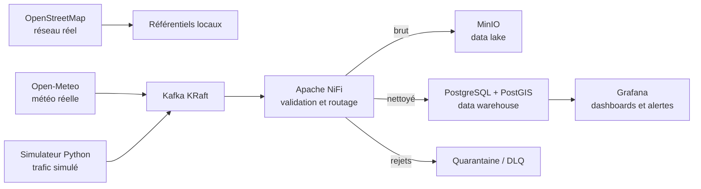

# Lome Smart Traffic

Plateforme locale de surveillance du trafic routier de Lomé, construite autour d'un pipeline de données en streaming.

> **Provenance :** réseau routier OpenStreetMap et météo Open-Meteo réels; trafic, capteurs et événements simulés. Aucune mesure publique de trafic à Lomé n'est revendiquée.

## Architecture cible



## Avancement

- [x] Phase 0 — initialisation et conventions
- [x] Phase 1 — infrastructure Docker Compose
- [x] Phase 2 — référentiels OSM et contrats de données
- [ ] Phase 3 — simulateur
- [ ] Phase 4 — ingestion NiFi et data lake
- [ ] Phase 5 — entrepôt PostGIS
- [ ] Phase 6 — transformation et chargement
- [ ] Phase 7 — qualité et observabilité
- [ ] Phase 8 — alertes
- [ ] Phase 9 — dashboards Grafana
- [ ] Phase 10 — tests, CI et durcissement
- [ ] Phase 11 — documentation portfolio
- [ ] Phase 12 — release

## Prérequis et démarrage

Installer Docker Desktop avec Compose v2, Git et GNU Make (ou WSL sous Windows). Toutes les données persistantes de ce projet sont stockées sous `.docker-data/` dans le checkout, donc sur le disque D: pour ce dépôt.

```sh
cp .env.example .env
make up
make bootstrap
```

`make up` démarre Kafka, NiFi, MinIO, PostgreSQL/PostGIS et Grafana; Kafka UI est optionnel (`make tools`). `make bootstrap` crée les topics et buckets et vérifie PostGIS. La pile utilise le port `localhost:5433` pour PostgreSQL afin d'éviter un conflit fréquent avec une instance locale sur 5432.

| Service | URL locale | Identifiants |
|---|---|---|
| NiFi | https://localhost:8443/nifi | valeurs `NIFI_USERNAME` / `NIFI_PASSWORD` de `.env` |
| MinIO API | http://localhost:9000 | valeurs MinIO de `.env` |
| MinIO Console | http://localhost:9001 | valeurs MinIO de `.env` |
| Grafana | http://localhost:3000 | valeurs Grafana de `.env` |
| Kafka UI | http://localhost:8080 | sans authentification, lancer `make tools` |
| Kafka | localhost:9092 | accès local de développement |
| PostgreSQL | localhost:5433 | valeurs PostgreSQL de `.env` |

## Données et licences

Le snapshot routier OSM est attribué « © OpenStreetMap contributors (ODbL) ». Les limites d'extraction, date, emprise et hypothèses figurent dans [les sources de données](docs/data-sources.md). Open-Meteo est prévu pour la météo; ses conditions non commerciales et ses quotas sont documentés dans la même page. Les capteurs, mesures de trafic et événements sont toujours fictifs et portent `data_origin=simulated`.

Les référentiels se régénèrent hors réseau depuis le snapshot commité avec `make references`. Pour renouveler le snapshot, `make osm-fetch` lance une requête ponctuelle à Overpass; les tests n'appellent aucune API externe.

Voir le [dictionnaire de données](docs/data-dictionary.md), les [définitions des KPIs](docs/kpis.md) et les [sources, licences et limites](docs/data-sources.md).

## Structure

- `data/reference/osm/` : snapshot OSM réduit, versionné
- `data/reference/` : tronçons, capteurs et zones dérivés
- `simulator/schemas/` : contrats JSON Schema des topics Kafka
- `scripts/` : extraction OSM et génération hors ligne des référentiels
- `docs/` : architecture, sources, dictionnaire, KPIs et ADR

## Conventions

- Documentation en français; code, identifiants et commits en anglais.
- Commits Conventional Commits; une phase est livrée et poussée avant la suivante.
- Aucun secret, volume Docker ou donnée générée ne doit être versionné.
