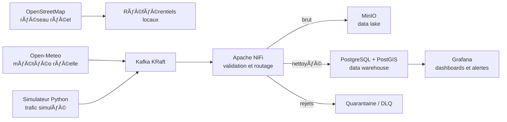

# Lome Smart Traffic

Plateforme locale de surveillance du trafic routier de Lomé, construite autour d'un pipeline de données en streaming.

> **Provenance des données :** le réseau routier OpenStreetMap et la météo Open-Meteo sont réels. Les mesures de trafic et les événements sont simulés ; aucune donnée publique de capteurs de trafic pour Lomé n'est revendiquée.

## Architecture cible



## Avancement

- [x] Phase 0 — initialisation et conventions
- [ ] Phase 1 — infrastructure Docker Compose
- [ ] Phase 2 — référentiels OSM et contrats de données
- [ ] Phase 3 — simulateur
- [ ] Phase 4 — ingestion NiFi et data lake
- [ ] Phase 5 — entrepôt PostGIS
- [ ] Phase 6 — transformation et chargement
- [ ] Phase 7 — qualité et observabilité
- [ ] Phase 8 — alertes
- [ ] Phase 9 — dashboards Grafana
- [ ] Phase 10 — tests, CI et durcissement
- [ ] Phase 11 — documentation portfolio
- [ ] Phase 12 — release

## Prérequis et démarrage

La cible est une exécution 100 % locale via Docker Compose. Installer Docker Desktop avec Compose v2, Git et Make (ou GNU Make sous Windows via WSL). À partir de la phase infrastructure :

```sh
cp .env.example .env
make up
```

Les services, ports et étapes de bootstrap seront précisés dans les phases suivantes. La phase 0 ne démarre encore aucun service.

## Données et licences

Les données OpenStreetMap sont soumises à l'ODbL et doivent être attribuées : « © OpenStreetMap contributors (ODbL) ». Open-Meteo est la source prévue pour la météo ; les conditions d'utilisation et limites de requêtes seront documentées avant intégration. Les événements et mesures de trafic synthétiques seront toujours marqués `data_origin=simulated`.

## Structure

Les répertoires `simulator/`, `nifi/`, `sql/`, `grafana/`, `scripts/`, `tests/`, `data/` et `docs/` accueillent les composants prévus. Les répertoires encore vides sont conservés par `.gitkeep` jusqu'à leur première implémentation.

## Conventions

- Documentation en français ; code, identifiants et commits en anglais.
- Commits selon Conventional Commits.
- Aucun secret, volume Docker ou donnée générée ne doit être versionné.
- Une phase est livrée et taguée avant de commencer la suivante.
# Infrastructure locale

Les services Compose utilisent des tags d'images exacts consignés dans `.env.example`. Copier ce fichier en `.env` avant de démarrer. Les identifiants fournis sont réservés au développement local.

```sh
cp .env.example .env
make up
make bootstrap
```

`make up` démarre la pile et les outils optionnels (Kafka UI). `make bootstrap` crée les topics Kafka, les buckets MinIO et vérifie PostGIS. Les scripts de bootstrap peuvent être rejoués. Les données sont conservées dans des volumes Docker nommés. `make reset` les supprime après confirmation.

| Service | URL locale | Identifiants |
|---|---|---|
| NiFi | https://localhost:8443/nifi | valeurs `NIFI_USERNAME` / `NIFI_PASSWORD` de `.env` |
| MinIO API | http://localhost:9000 | valeurs `MINIO_ROOT_USER` / `MINIO_ROOT_PASSWORD` de `.env` |
| MinIO Console | http://localhost:9001 | mêmes identifiants MinIO |
| Grafana | http://localhost:3000 | valeurs `GRAFANA_ADMIN_USER` / `GRAFANA_ADMIN_PASSWORD` de `.env` |
| Kafka UI | http://localhost:8080 | sans authentification, lancer avec `make tools` |
| Kafka | localhost:9092 | accès local de développement |
| PostgreSQL | localhost:5432 | valeurs `POSTGRES_USER` / `POSTGRES_PASSWORD` de `.env` |

Compose réserve environ 5,4 Gio de limites mémoire pour les services, laissant une marge pour Docker et le système sur une machine de 8 Go. NiFi est le plus gourmand. Si la mémoire disponible est inférieure, les interfaces optionnelles peuvent être désactivées avec `docker compose up -d kafka nifi minio postgres grafana`; MinIO bootstrap reste accessible via son service de profil.

Le broker Kafka est un nœud combiné broker/contrôleur en KRaft. Cette configuration convient au développement local, pas à une installation haute disponibilité.
